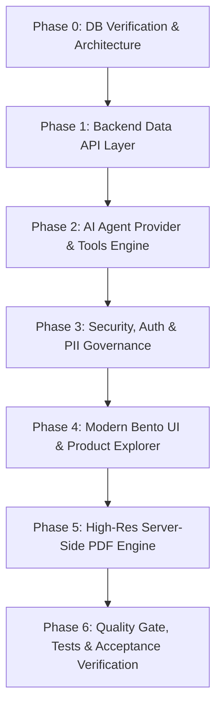

# Enterprise E-Commerce Analytics Platform & AI Assistant Agent
## Architectural Specification & Execution Blueprint

**System Version**: 1.0.0-PROD  
**Database**: CockroachDB CCL v26.2.9 (AWS `ap-south-1`)  
**Target Schema**: `olist` (Brazilian E-Commerce Enterprise Dataset)  
**Security Posture**: Strictly Read-Only, Zero-Raw-SQL AI Agent, PII Masking, Rate-Limited Token Budget  

---

## 1. System Topology & Technology Stack

```
┌────────────────────────────────────────────────────────────────────────┐
│                        CLIENT / USER LAYER                             │
│   React 18 + Vite + TypeScript + Tailwind CSS + Framer Motion          │
│   Recharts Visualizations + Lucide Icons + Fontsource Plus Jakarta     │
│   (Bento Layout, Floating Sidebar, AI Quick Box, Live Product Explorer)│
└─────────────────────────────────┬──────────────────────────────────────┘
                                  │ HTTPS / REST + SSE (/api/v1/...)
┌─────────────────────────────────▼──────────────────────────────────────┐
│                    FASTAPI BACKEND GATEWAY                             │
│  - JWT Cookie Auth & RBAC (Admin / Viewer)                             │
│  - Rate Limiter (Token Bucket per IP/User)                             │
│  - In-Process Multi-Level TTL Cache (KPIs: 60s, Timeseries: 5m)        │
│  - Audit Logging & Structured Redacted Event Logging                   │
└──────────────┬──────────────────────────────────────────┬──────────────┘
               │ Parameterized SQL Execution              │ Tool Calling
┌──────────────▼───────────────────────────┐  ┌───────────▼──────────────┐
│       COCKROACHDB DATA LAYER             │  │   AI AGENT ORCHESTRATOR  │
│ - Dedicated Read-Only Session            │  │ - Provider Abstraction   │
│ - Statement Timeout: 5000ms              │  │   (Gemini & Groq)        │
│ - Automatic 40001 Retry Wrapper          │  │ - Fallback Engine        │
│ - Strict SQL parameterization (No ORM DDL│  │ - 7 Parameterized Tools  │
│ - 11 Core Olist Operational Tables       │  │ - Strict Pydantic Schemas│
└──────────────────────────────────────────┘  │ - Zero Raw SQL Execution │
                                              │ - Token Budget Tracker   │
                                              └──────────────────────────┘
```

---

## 2. Live Database Schema & Metric Mapping

| Dashboard Metric | Source Database Table(s) | Computation Method | Missing Metrics & Honest Alternatives |
| :--- | :--- | :--- | :--- |
| **Gross Revenue (GMV)** | `olist.order_items`, `olist.orders` | `SUM(price + freight_value)` WHERE `order_status = 'delivered'` | Accurate across 96,478 delivered orders. |
| **Delivered Orders** | `olist.orders` | `COUNT(order_id)` WHERE `order_status = 'delivered'` | Total order volume is 99,441. |
| **Units Sold** | `olist.order_items` | `COUNT(order_item_id)` | 110,197 items sold. |
| **Active Customers** | `olist.customers` | `COUNT(DISTINCT customer_unique_id)` | **Missing**: Web impressions, bounce rate. **Honest Alternative**: Label as "Active Unique Customers" (96,096) rather than fabricating web visitor stats. |
| **Products & SKUs** | `olist.products`, `olist.product_categories` | Direct catalog mapping (32,951 SKUs across 73 categories) | **Missing**: Live warehouse inventory / stock levels. **Honest Alternative**: Display "30-Day Sales Velocity" and categorize demand tier instead of fake stock numbers. |
| **Refunds / Returns** | `olist.orders`, `olist.reviews` | `order_status = 'canceled'` (625 orders = 0.63%) | **Missing**: Explicit refund ledgers. **Honest Alternative**: Track cancellation rate & 1-star delivery complaints. |
| **Customer Sentiment** | `olist.reviews` | Average score across 98,410 reviews (4.09/5.0) | Verbatim review texts available with PII masking. |
| **Geographic Sales** | `olist.customers`, `olist.geolocations` | `GROUP BY state, city` | 42% volume in São Paulo (SP), 13% RJ, 11.7% MG. |

---

## 3. Core Architectural Modules

### 3.1 Backend Data & API Layer (`/api/v1/...`)
- `/overview/kpis`: Current period vs previous period values, percentage delta, and direction pill (`positive` / `negative`).
- `/overview/timeseries`: Daily and monthly GMV, order volume, and freight velocity using `DATE_TRUNC`.
- `/overview/categories`: Category breakdown ranked by revenue and units.
- `/overview/geo`: State-by-state order concentration and average freight.
- `/products`: Search, filtering (category, price bounds), sorting, and cursor-based pagination.
- `/products/:id`: Live deep statistics (revenue, units, AOV, sales trend, co-occurring "Frequently Bought Together" SKUs).
- `/orders`: Keyset-paginated order ledger with order item details.
- `/agent/chat`: SSE streaming endpoint with token-by-token output and tool call event notifications.
- `/agent/usage`: Live token consumption, request counts, rate limit budget, and estimated cost.
- `/report/pdf`: Server-side generation of publication-ready PDF dossiers.

### 3.2 AI Agent Orchestration (Tool-Based, Zero Raw SQL)
- **Interface**: Abstract `LLMProvider` with concrete implementations:
  1. `GeminiProvider` (Google Gemini 1.5 Flash)
  2. `GroqProvider` (Groq Llama-3.3-70B-Versatile)
- **Fallback Engine**: Dynamic `auto` mode that detects available keys, executes tool calling, and automatically falls back on rate limits (`429`) or server errors (`5xx`) with exponential backoff and jitter.
- **Typed Parameterized Tools**:
  1. `get_kpis(date_range)`
  2. `sales_by_category(date_range, limit)`
  3. `top_products(date_range, limit, category_id)`
  4. `orders_trend(date_range, granularity)`
  5. `customers_by_country(date_range, limit)`
  6. `compare_periods(metric, range_a, range_b)`
  7. `find_anomalies(metric, date_range)`
  8. `product_stats(product_id, date_range)`
  9. `compare_products(product_ids, date_range)`
  10. `product_search(query, limit)`

### 3.3 Security & Read-Only Governance
- Strict database read-only session: `SET default_transaction_read_only = on;` and `SET statement_timeout = 5000;`.
- PII Masking: Redacts customer IDs, postal prefixes, and personal comments before transmitting to LLMs or PDF generators.
- Input Sanitization: Strict regex and Pydantic validation on all parameters; zero string concatenation in SQL.
- Prompt Injection Defense: DB text delimited as untrusted data; agent lacks any destructive tools.

---

## 4. Phase Execution & Verification Plan



- **Phase 0 (Current)**: DB verification, write-privilege audit, `/db/proposed_changes.sql`, schema-to-feature mapping, and user alignment.
- **Phase 1**: FastAPI backend setup, connection pooling with 5s statement timeout, analytical endpoints, in-memory TTL caching.
- **Phase 2**: Multi-provider LLM abstraction (Gemini + Groq), typed tool execution engine, SSE streaming, rate limiting, and token budgets.
- **Phase 3**: JWT cookie authentication, role-based access, prompt injection defense, audit logging, and `/docs/SECURITY.md`.
- **Phase 4**: Modern Bento UI (React 18 + Vite + Tailwind + Framer Motion + Recharts + Lucide Icons), AI Quick Box, and Live Product Explorer.
- **Phase 5**: High-resolution server-side PDF generator (`/api/v1/report/pdf`).
- **Phase 6**: Unit/integration tests, SQL injection validation test, load benchmark, and final acceptance verification.
